# MindGate: AI-Driven Digital Wellbeing & Gadget Addiction Regulation Ecosystem


> **MindGate** is an intelligent, multi-role digital-wellbeing ecosystem designed to predict, monitor, and regulate electronic gadget overuse among students using Artificial Intelligence, real-time accessibility enforcement, and a collaborative parent-student regulatory framework.

---

## 📋 Table of Contents

1. [Project Overview](#project-overview)
2. [Problem Statement](#problem-statement)
3. [Project Objectives](#project-objectives)
4. [Key Features](#key-features)
5. [System Architecture](#system-architecture)
6. [Application Workflow](#application-workflow)
7. [Technology Stack](#technology-stack)
8. [Project Directory Structure](#project-directory-structure)
9. [Machine Learning Methodology](#machine-learning-methodology)
10. [Backend Architecture & API Specs](#backend-architecture--api-specs)
11. [Firebase Integration & Identity Alignment](#firebase-integration--identity-alignment)
12. [Installation & Setup Guide](#installation--setup-guide)
13. [Running the Application](#running-the-application)
14. [Application Screenshots](#application-screenshots)
15. [Security Considerations](#security-considerations)
16. [Future Enhancements](#future-enhancements)
17. [Contributors](#contributors)
18. [Acknowledgements](#acknowledgements)
19. [License](#license)

---

## 💡 Project Overview

Electronic gadget addiction and excessive screen time pose severe risks to students' physical health, academic performance, and emotional stability. Existing screen time tools act merely as passive counters or rigid blockers that are easily bypassed.

**MindGate** addresses this challenge by providing an end-to-end digital wellbeing ecosystem powered by machine learning. It continuously evaluates behavioral survey indicators, calculates personalized risk profiles (**Low, Moderate, High, Severe**), enforces intelligent app restrictions using Android background services, and enables a collaborative parental approval loop for extended screen time.

---

## 🎯 Problem Statement

Unregulated smartphone usage among teenagers and university students leads to:
* **Sleep Disruption & Physical Strain**: Late-night screen exposure suppresses melatonin and causes eye strain, headaches, and posture issues.
* **Academic Decline**: Habitual phone checking during study hours and missed lectures lead to lower academic performance.
* **Loss of Self-Regulation**: Traditional app blockers lack adaptive mechanisms, leading students to disable enforcement tools entirely.
* **Lack of Parental Visibility**: Parents often lack real-time visibility into their children's excessive digital habits or a frictionless way to grant earned extensions.

---

## 🎯 Project Objectives

1. **AI-Based Addiction Risk Prediction**: Classify student addiction risk using a trained CatBoost Gradient Boosting classifier evaluated on 44 clinical and behavioral indicators.
2. **Clinical Danger-Gate Validation**: Prevent false-alarm Severe classifications through a 3-gate clinical validation safety check.
3. **Adaptive Enforcement**: Enforce local app limits on Android devices using a background Accessibility Watchdog Service and dark-themed focus overlay.
4. **Self-Regulation & Earned Extensions**: Empower students to earn extra screen time by completing cognitive Wellness Challenges (Math/Trivia puzzles).
5. **Real-Time Collaborative Oversight**: Connect students and parents via a secure, code-based handshake (`MG-XXXXXX`), enabling instant Firestore-based extension requests and FCM notifications.
6. **Cohort Analytics for Educators**: Provide teachers and academic counselors with a dedicated portal for bulk student dataset analysis (up to 2,000 records) and class-wide risk distribution.

---

## ✨ Key Features

### 👨‍🎓 Student Portal
* **Science-Backed Risk Assessment**: A 5-step interactive survey mapping physical symptoms, study impact, compulsiveness, and sleep disruption.
* **Dynamic Screen Time Ring**: Real-time daily usage visualization with proportional top-app consumption progress bars.
* **Intelligent App Restrictions**: Set daily time limits per package name with optional bedtime curfew locks.
* **Wellness Challenges**: Solve math or trivia puzzles to self-earn 15-minute time grants.
* **Collaborative Time Requests**: Request extra time directly from a linked parent with live status tracking (`PENDING`, `APPROVED`, `DENIED`, `CONSUMED`).

### 👨‍👩‍👦 Parent Portal
* **Cross-Platform Pairing Handshake**: Link child accounts using an 8-character pairing code with real-time Firestore sync.
* **Child Usage Analytics**: Live monitoring of daily screen time, top restricted apps, and active extensions.
* **Instant Push Approvals**: Receive high-priority FCM notifications and approve or deny extension requests in `< 500ms`.
* **Remote Limit Adjustment**: Update child app curfews and daily caps remotely.

### 👨‍🏫 Teacher & Counselor Portal
* **Bulk Dataset Upload**: Analyze group datasets (CSV/XLSX up to 2,000 records) for class-wide addiction risk analysis.
* **Class Risk Visualizer**: Stacked risk distribution bar charts (Low, Moderate, High, Severe) for cohort evaluation.
* **Student Risk Breakdown**: Detailed individual risk scores, sub-score bars (Compulsion, Physical, Academic, Control), and SHAP feature drivers.
* **CSV Template Generator**: Download standardized dataset collection templates directly from the app.

---

## 🏗 System Architecture

MindGate follows a 3-tier distributed client-server architecture:

```
+-------------------------------------------------------------------------+
|                         PRESENTATION LAYER                              |
|                       (Android Application)                             |
|  - Jetpack Compose (Material 3)    - Room DB (Local Offline Cache)      |
|  - Accessibility Watchdog Service   - Hilt Dependency Injection         |
+------------------------------------+------------------------------------+
                                     |
                         HTTP / REST | JSON (Retrofit 2)
                                     v
+-------------------------------------------------------------------------+
|                       INTELLIGENCE LAYER                                |
|                        (FastAPI Backend)                                |
|  - FastAPI (Async Python 3.12)      - CatBoost ML Classifier            |
|  - Risk Engine (Danger-Gate Logic) - SHAP Explainability Engine         |
+-------------------+--------------------------------+--------------------+
                    |                                |
        SQLAlchemy  |                                | Firebase Admin
        ORM         v                                v SDK
+-------------------+----------------+ +----------------------------------+
|          PERSISTENT DATA           | |       REAL-TIME SYNC LAYER       |
|    SQLite / PostgreSQL Database    | |   Firebase Auth & Cloud Firestore |
|  - User Credentials & Hashed Pass  | |  - Parent-Child Live Links       |
|  - Parent-Child Pairing Records    | |  - Real-time Extension Requests  |
|  - Usage & Assessment Records      | |  - FCM Push Notifications        |
+------------------------------------+ +----------------------------------+
```

---

## 🔄 Application Workflow

### 1. Registration & Custom Token Identity Alignment
```
[User App] ---> (POST /api/auth/register) ---> [FastAPI Backend]
                                                       |
                                            Create SQL User Record
                                                       |
                                         Generate Firebase Custom Token
                                            (UID = Backend User ID)
                                                       v
[User App] <--- (Returns JWT + Custom Token) <--- [FastAPI Backend]
    |
Sign into Firebase Auth with Custom Token
(Guarantees SQL ID 108 == Firebase UID 108)
```

### 2. Parent-Student Pairing Handshake
```
[Student Device]                              [Parent Device]
       |                                             |
Generates 8-char code                                |
(POST /api/parent/link/create)                       |
       |                                             |
Shows "MG-7K4P9X" code --------------------> Enters "MG-7K4P9X" code
                                            (POST /api/parent/link/accept)
                                                     |
                                           Establishes Link in SQL &
                                           Writes 'parentChildLinks'
                                           Document in Firestore
                                                     v
[Student Device] <======= (Real-time Sync) ======> [Parent Device]
```

---

## 🛠 Technology Stack

### 📱 Android Client
* **Language**: Kotlin `1.9.22`
* **UI Framework**: Jetpack Compose (Material 3)
* **Architecture**: MVVM + Clean Architecture with Coroutines & StateFlow
* **Dependency Injection**: Hilt `2.50`
* **Local Database**: Room DB `v14` (Offline caching & grant persistence)
* **Preferences**: DataStore Preferences
* **Networking**: Retrofit `2.9.0` + OkHttp `4.12.0`
* **System Monitoring**: `AccessibilityService` (`MindGateAccessibilityService`), `UsageStatsManager`

### ⚙️ Backend & AI Engine
* **Language**: Python `3.12`
* **Web Framework**: FastAPI `1.0.0` with Uvicorn ASGI
* **ORM & Database**: SQLAlchemy (SQLite for dev, PostgreSQL-ready)
* **Authentication**: PyJWT / `python-jose` (HS256), `passlib` (pbkdf2_sha256)
* **ML Classifier**: CatBoost Classifier `1.2.x`
* **ML Tools**: scikit-learn, pandas, numpy, Optuna (Hyperparameter Tuning), SMOTE (`imbalanced-learn`)
* **Explainability**: SHAP (TreeExplainer)

### 🔥 Cloud & Real-time Services
* **Identity Provider**: Firebase Auth (Custom Token Auth)
* **Real-time Database**: Cloud Firestore (Extension requests & live listeners)
* **Push Engine**: Firebase Cloud Messaging (FCM V1 API)

---

## 📂 Project Directory Structure

```
gadget_addiction_project/
├── mindgate-android/                 # Android Jetpack Compose Application
│   ├── app/
│   │   ├── src/main/java/com/mindgate/
│   │   │   ├── data/                 # Data Layer (DAOs, Room DB, Retrofit APIs, Repositories)
│   │   │   │   ├── local/            # Room Database & DataStore Preferences
│   │   │   │   ├── remote/           # Retrofit DTOs & API interfaces
│   │   │   │   └── repository/       # Repository implementations
│   │   │   ├── domain/               # Business Logic Layer (PolicyEngine, ExtensionManager)
│   │   │   ├── presentation/         # UI Layer (Compose Screens, Navigation, ViewModels)
│   │   │   │   ├── ui/auth/          # Login, Register & Role Selection
│   │   │   │   ├── ui/home/          # Student Dashboard & Growth Chart
│   │   │   │   ├── ui/parent/        # Parent Dashboard & Child Analytics
│   │   │   │   ├── ui/teacher/       # Teacher Analytics & Batch Upload
│   │   │   │   ├── ui/blocked/        # Focus Lock Overlay
│   │   │   │   ├── ui/quiz/           # Wellness Challenge Puzzles
│   │   │   │   └── navigation/        # NavGraph & Role Guards
│   │   │   ├── parent/               # Accessibility Watchdog & Approval Broadcast Receiver
│   │   │   ├── service/              # Foreground Usage Monitor & WorkManager Jobs
│   │   │   └── util/                 # Assessment Mappers, UsageStatsHelper & AppInfo
│   │   ├── build.gradle.kts
│   │   ├── google-services.json
│   │   └── firestore.rules           # Cloud Firestore Security Rules
│   └── build.gradle.kts
│
├── project/                          # FastAPI Backend & ML Pipeline
│   ├── api/                          # FastAPI Web Endpoints & Service Layer
│   │   ├── main.py                   # API Entry Point & Router Definitions
│   │   ├── auth.py                   # JWT Generation & Password Hashing
│   │   ├── models.py                 # SQLAlchemy Database Schemas
│   │   ├── schemas.py                # Pydantic Schemas & DTOs
│   │   ├── model_service.py          # ML Inference Singleton
│   │   └── firebase_utils.py         # Firebase Admin SDK & FCM Push Engine
│   ├── src/                          # Training & Data Pipelines
│   │   ├── data_loader.py            # Dataset Loader & Leakage Removal
│   │   ├── preprocessor.py           # Ordinal Encoding & Column Transformations
│   │   ├── model_trainer.py          # 11-Model Training & Optuna Tuning
│   │   ├── model_selector.py         # Leaderboard Ranking & Artifact Serialization
│   │   ├── explainability.py         # SHAP Value Computation & Summaries
│   │   └── report_model_comparison.py# Standalone Model Comparison Generator
│   ├── models/                       # Trained Serialized Artifacts (.pkl & .json)
│   ├── data/                         # Augmented Survey Dataset (augmented_dataset_final.xlsx)
│   ├── reports/                      # Cross-Validation & Metric CSV/Markdown Reports
│   ├── report_outputs/               # Generated Visual Report Artifacts
│   ├── requirements.txt              # Python Dependencies
│   ├── train.py                      # Training Pipeline Entry Point
│   ├── evaluate.py                   # Post-Training Model Evaluation
│   ├── predict.py                    # CLI Prediction Script
│   ├── risk_engine.py                # Clinical Danger-Gate Validation Engine
│   └── recommendation_engine.py       # Tiered Non-Diagnostic Recommendation System
│
├── docs/                             # Documentation & Reference Media
│   ├── reference/                    # MindGate Figures PDF Reference Document
│   └── screenshots/                  # High-Resolution Extracted Screenshots
├── MINDGATE_PROJECT_GUIDE.md         # Master Technical Architecture Specification
├── GITHUB_PREPARATION_REPORT.md      # Security Audit & Git Exclusions Report
├── FINAL_GITHUB_SECURITY_CHECK.md    # Final Pre-Upload Security Check
└── README.md                         # Project Root Documentation
```

---

## 🤖 Machine Learning Methodology

### 1. Dataset & Features
* **Records**: 396 survey samples, 64 raw columns, 44 usable behavioral features after data leakage removal.
* **Target Classes**: `Corrected_Label` ∈ {**Low**, **Moderate**, **High**, **Severe**}.
* **Feature Categories**: Physical symptoms (headaches, eye strain), daily screen time bands, night usage frequency, phone check frequency, academic impact (missed classes, CGPA), and emotional dependence.

### 2. Preprocessing & Leakage Prevention
* **Data Leakage Removal**: All target-derived scores (`score_usage_compulsion`, `danger_marker_count`, `gate1_score_valid`, etc.) are excluded during model training and retained strictly for post-processing validation.
* **Encoding**: Unified ordinal band mapping (`<2` → 0, `2-3` → 1, ..., `9+` → 5) and frequency encoding (`Never` → 0, ..., `Always` → 5).
* **Imbalance Handling**: Synthetic Minority Over-sampling Technique (SMOTE) applied inside cross-validation folds.

### 3. Model Comparison & Leaderboard
Eleven machine learning classifiers were evaluated using 5-fold Stratified Cross-Validation:

| Rank | Model | 5-Fold CV Accuracy | 5-Fold CV F1 Score | Test Set Accuracy | Test Set F1 Score | Test ROC-AUC (OvR) |
| :---: | :--- | :---: | :---: | :---: | :---: | :---: |
| **1** | **CatBoost** ⭐ | **0.9759** | **0.9758** | **0.9250** | **0.8969** | **0.9916** |
| 2 | Extra Trees | 0.9650 | 0.9650 | 0.9250 | 0.8917 | 0.9872 |
| 3 | LightGBM | 0.9649 | 0.9649 | 0.9000 | 0.8465 | 0.9798 |
| 4 | Random Forest | 0.9650 | 0.9648 | 0.9125 | 0.8556 | 0.9875 |
| 5 | SVM (RBF) | 0.9627 | 0.9626 | 0.9625 | 0.9478 | 0.9890 |

**CatBoost** was automatically selected as the production model due to its superior generalization on categorical survey data.

### 4. Clinical Danger-Gate Validation
A predicted **Severe** risk classification undergoes 3 mandatory validation checks:
1. `gate1_score_valid`: Computed score threshold met (`≥ 65`).
2. `gate2_danger_met`: Sufficient physical/behavioral danger markers present.
3. `gate3_loss_control`: Explicit loss-of-control marker confirmed.

*If any gate fails, the model output is automatically downgraded to **High** to prevent false Severe alarms.*

### 5. Explainability (SHAP)
Predictive drivers are extracted using `shap.TreeExplainer`. Top contributing features across the dataset include:
1. `sleep_disturbances`
2. `late_night_usage`
3. `Q28_PhysicalSymptoms_count`
4. `daily_screen_time_hours`
5. `Q13_AnxiousWithoutGadget`

---

## 🌐 Backend Architecture & API Specs

The backend is built with **FastAPI** and **Uvicorn**, providing asynchronous RESTful endpoints:

| Method | Endpoint | Access Level | Description |
| :--- | :--- | :--- | :--- |
| `GET` | `/health` | Public | Server health status and model load check. |
| `POST` | `/token` | Public | User authentication & JWT token generation. |
| `POST` | `/api/auth/register` | Public | User account registration & initial role assignment. |
| `POST` | `/api/auth/google` | Public | Google ID Token verification & sign-in. |
| `POST` | `/api/auth/google/complete` | Public | Complete role selection for new Google users. |
| `POST` | `/predict` | Authenticated | Single student addiction risk prediction. |
| `POST` | `/predict/batch/file` | Teacher | Bulk CSV/XLSX dataset processing for educators. |
| `POST` | `/api/parent/link/create` | Student | Generate 8-character pairing code (`MG-XXXXXX`). |
| `POST` | `/api/parent/link/accept` | Parent | Accept student code & establish active relationship. |
| `GET` | `/api/user/connection-status` | Authenticated | Fetch active parent-child link status and Firebase UIDs. |
| `POST` | `/api/parent/notify-request` | Student | Trigger FCM push notification to parent devices. |

---

## 🔥 Firebase Integration & Identity Alignment

Standard Firebase Auth generates random string UIDs (e.g. `JRFu9x...`), making relational database mapping difficult. MindGate solves this with **Firebase Custom Token Alignment**:

```
1. User authenticates via FastAPI -> Receives SQL User ID (e.g. 108).
2. Backend generates a Firebase Custom Token signed with UID = "108".
3. Mobile app calls FirebaseAuth.getInstance().signInWithCustomToken(token).
4. Firebase Auth UID becomes "108", aligning Firestore document paths directly with SQL primary keys.
```

### Cloud Firestore Structure:
* **`extension_requests/{requestId}`**: Stores real-time time extension requests (`studentUid`, `parentUid`, `appPackage`, `status`).
* **`parentChildLinks/{linkId}`**: Stores real-time parent-student pairing metadata.
* **`deviceTokens/{userId}`**: Stores FCM device tokens for targeted push notifications.
* **`extensionLedger/{ledgerId}`**: Stores an immutable audit trail of parent-approved time extensions.

---

## 💻 Installation & Setup Guide

### Prerequisites
* **JDK 17** or higher
* **Android Studio** (Jellyfish / Koala or newer)
* **Android SDK 35** (Min SDK 26 - Android 8.0+)
* **Python 3.10+** (Python 3.12 recommended)

---

### A. Python FastAPI Backend Setup

1. **Navigate to the backend directory**:
   ```bash
   cd project
   ```

2. **Create and activate a virtual environment**:
   ```bash
   # Windows (PowerShell)
   python -m venv venv
   .\venv\Scripts\Activate.ps1

   # Linux / macOS
   python3 -m venv venv
   source venv/bin/activate
   ```

3. **Install dependencies**:
   ```bash
   pip install -r requirements.txt
   ```

4. **Configure Environment Variables**:
   Copy `.env.example` to `.env` and set your secrets:
   ```bash
   cp .env.example .env
   ```
   *Edit `.env`*:
   ```env
   JWT_SECRET=your_secure_random_jwt_secret_key_here
   # FIREBASE_SERVICE_ACCOUNT_PATH=/path/to/firebase-service-account.json
   ```

5. **Train / Verify ML Model Artifacts**:
   ```bash
   python main.py train
   ```

---

### B. Android Application Setup

1. **Open Project in Android Studio**:
   Open **Android Studio** → select **Open** → navigate to `mindgate-android/`.

2. **Sync Gradle**:
   Allow Android Studio to download Gradle dependencies and perform project sync.

3. **Verify Firebase Configuration**:
   Ensure `google-services.json` is located in `mindgate-android/app/google-services.json`.

---

## 🚀 Running the Application

### 1. Start the FastAPI Backend
From the `project/` directory:
```bash
python main.py serve
```
*The server starts on `http://0.0.0.0:8000`. Interactive API documentation is available at [http://localhost:8000/docs](http://localhost:8000/docs).*

### 2. Run the Android App
* **Android Emulator**: Run the app from Android Studio. The app communicates with the backend via `http://10.0.2.2:8000/`.
* **Physical Device**: Connect your device to the same Wi-Fi network as your PC. Open **Connection Settings** (gear icon on Login screen) and set the API Base URL to your PC's IP address (e.g. `http://192.168.1.100:8000/`).

---

## 🖼 Application Screenshots

### 1. System Architecture & Machine Learning Pipeline

| Model Comparison & Leaderboard Output | Cloud Firestore Security Rules |
| :---: | :---: |
| 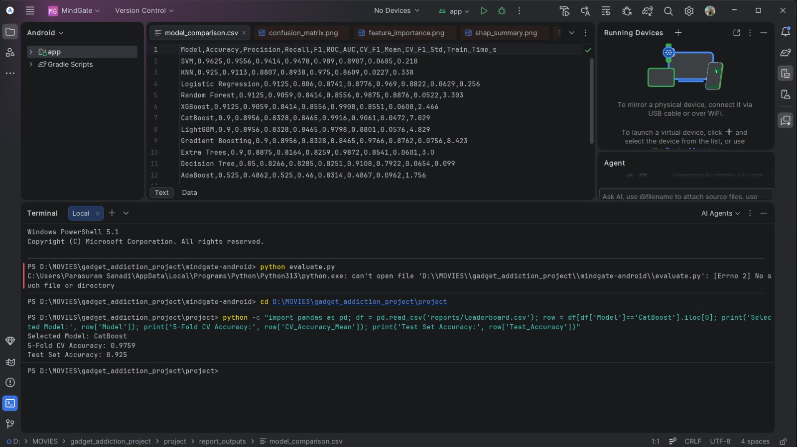 | 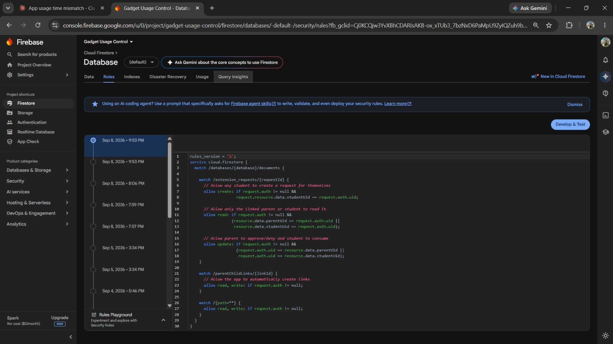 |
| *Figure 1: Candidate model metrics & CatBoost selection.* | *Figure 2: Security rules published in Firebase console.* |

---

### 2. Onboarding & Permissions Setup

| Onboarding & Role Selection | Permission Setup Screen |
| :---: | :---: |
| 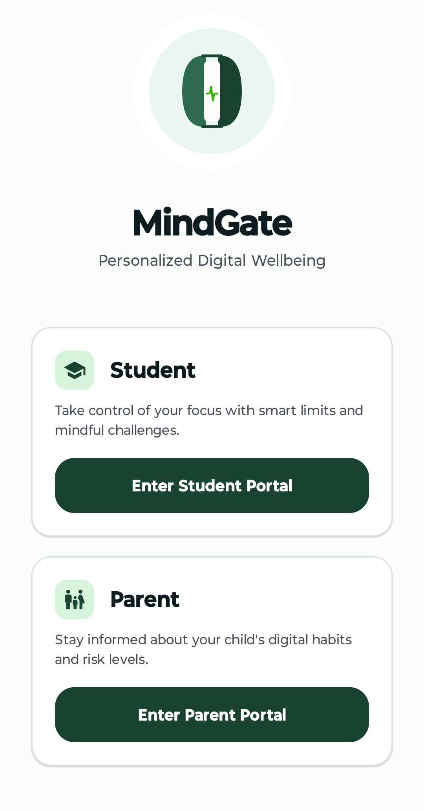 | 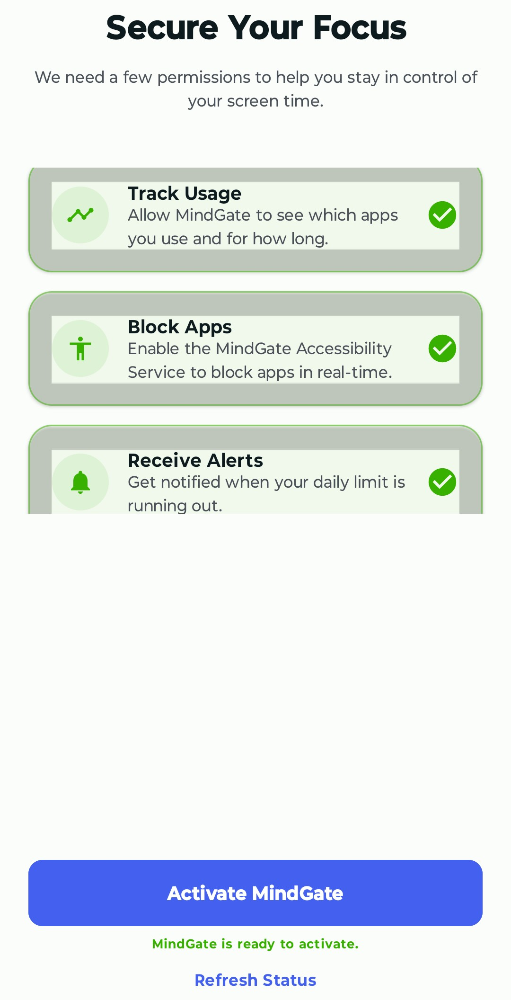 |
| *Figure 3: Student and Parent portal onboarding entry.* | *Figure 4: Usage, Accessibility, and Notification permissions granted.* |

---

### 3. Student Portal & AI Risk Assessment

| Self-Assessment Survey | AI Risk Analysis Result |
| :---: | :---: |
| 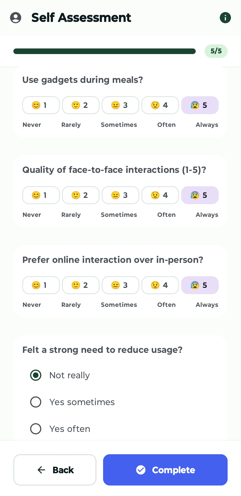 | 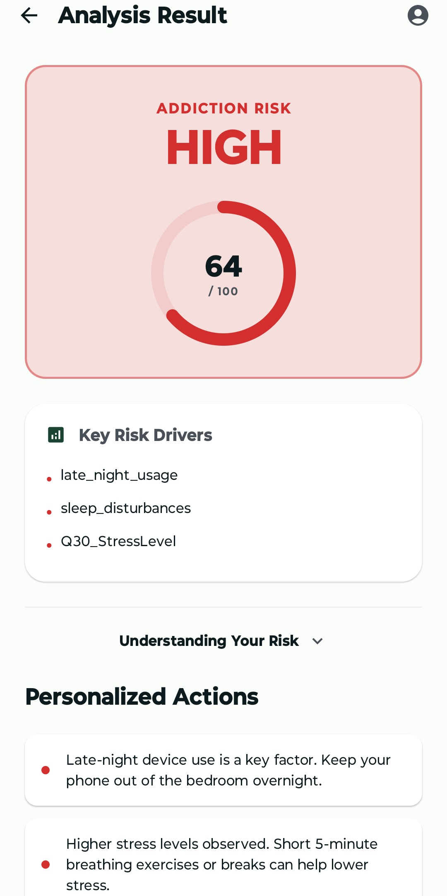 |
| *Figure 5: Science-backed survey on a 1-5 scale.* | *Figure 6: HIGH risk (64/100), SHAP drivers, & personalized actions.* |

| Student Usage Dashboard | Explore & Recharge | Growth Journey Screen |
| :---: | :---: | :---: |
| 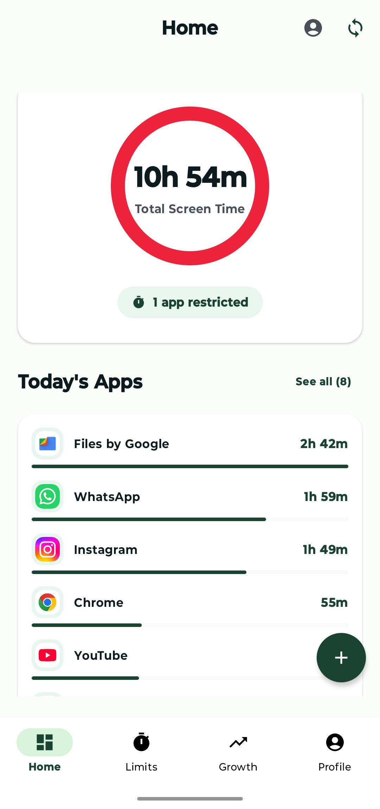 | 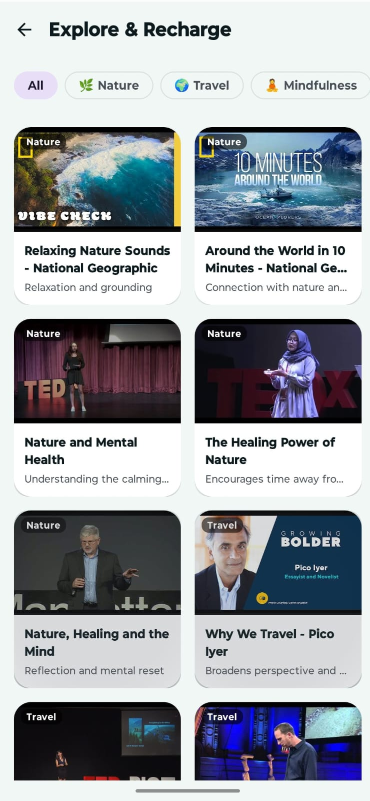 | 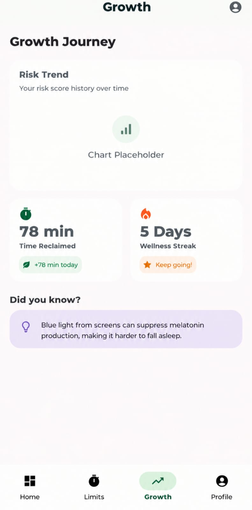 |
| *Figure 7: Total screen time ring & top app usage.* | *Figure 8: Curated wellness videos by category.* | *Figure 9: Risk trend, time reclaimed, & streak.* |

---

### 4. Device Pairing & Parental Oversight

| Parent Link Code | Parent Monitoring Dashboard |
| :---: | :---: |
| 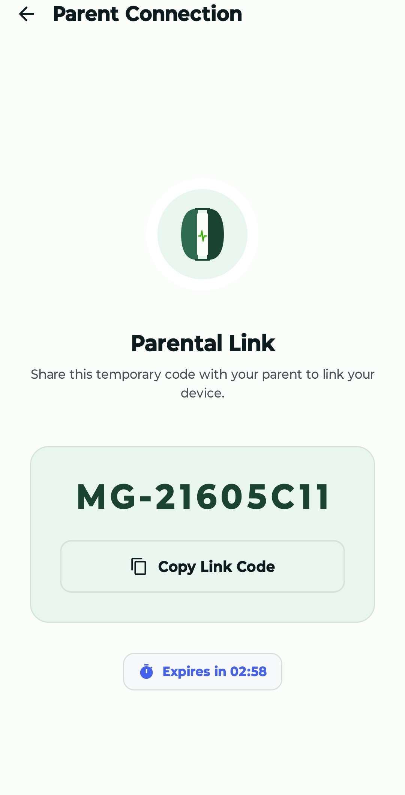 | 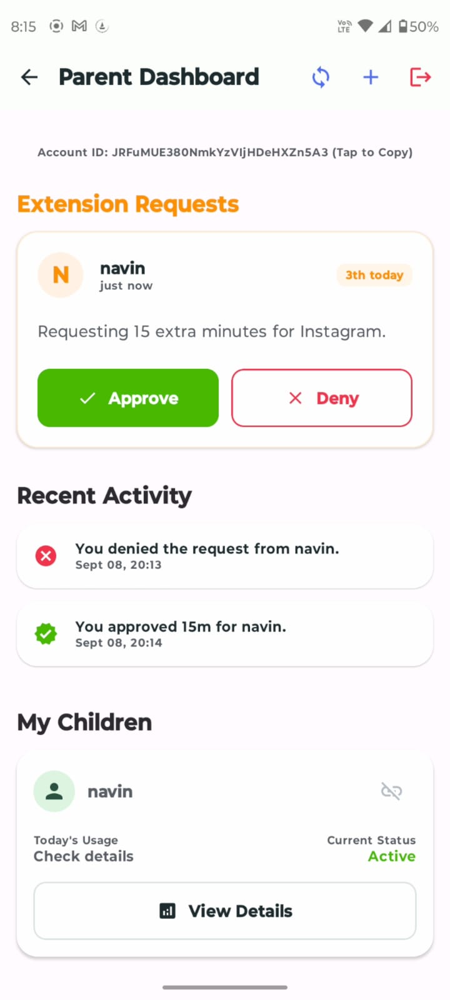 |
| *Figure 10: `MG-XXXXXX` pairing code with 3-min timer.* | *Figure 15: Pending request, approve/deny activity, & child card.* |

---

### 5. App Restrictions & Self-Regulation Challenges

| Focus Lock Overlay | Wellness Quiz Challenge |
| :---: | :---: |
| 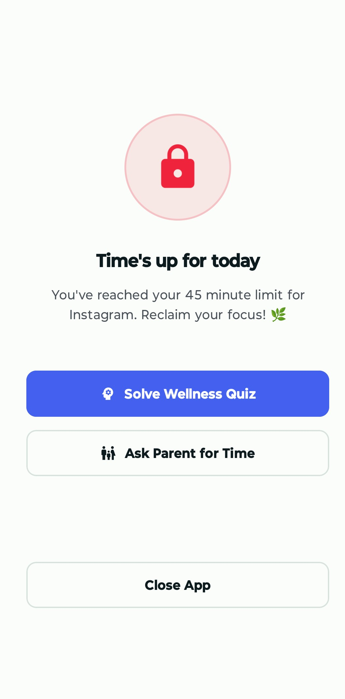 | 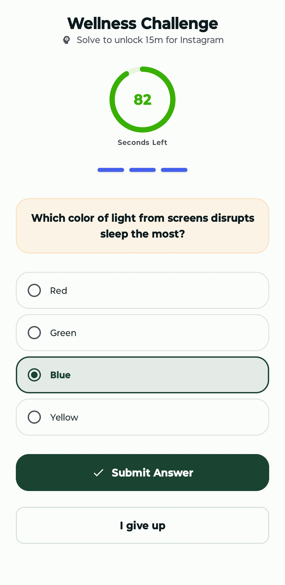 |
| *Figure 11: Hard block with quiz & ask-parent options.* | *Figure 12: Timed quiz to earn 15-min extension.* |

| Extension Unlocked | Awaiting Parent Approval |
| :---: | :---: |
| 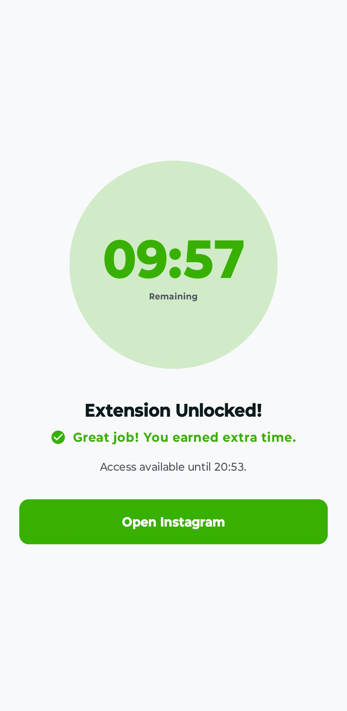 | 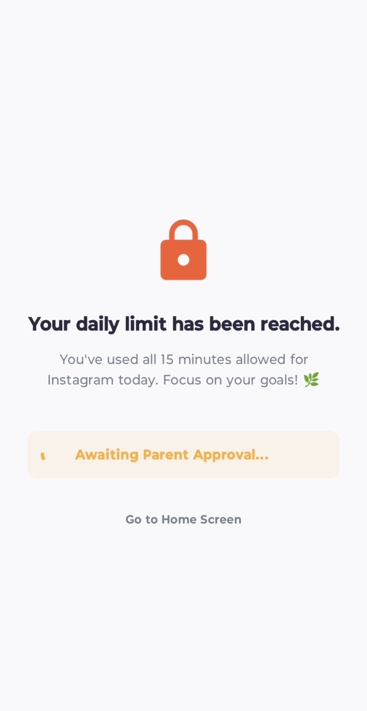 |
| *Figure 13: Countdown after extension grant.* | *Figure 14: Blocked screen awaiting parent decision.* |

---

### 6. Educator Portal & Cohort Analytics

| Teacher Dataset Upload | Class Risk Summary |
| :---: | :---: |
| 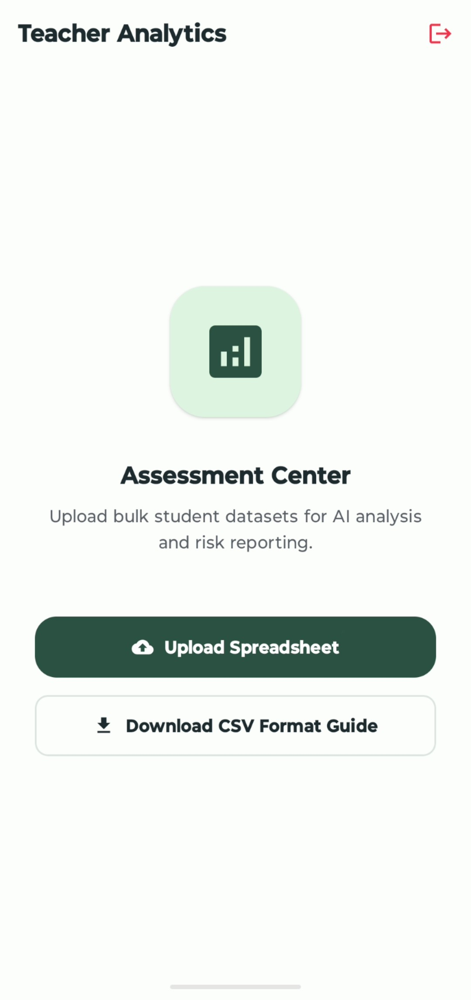 | 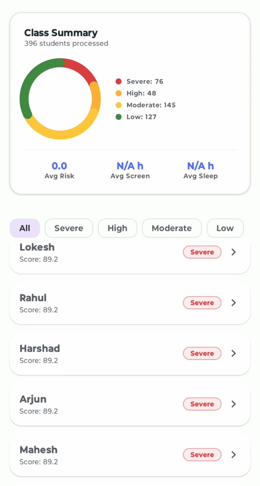 |
| *Figure 16: Bulk spreadsheet upload & CSV format guide.* | *Figure 17: 396 students, risk distribution donut, & roster list.* |

---

## 🔒 Security Considerations

* **Environment Variables**: Never commit `.env` files or private key files to Git. All secrets are managed via `os.getenv("JWT_SECRET")`.
* **Service Account Credentials**: `firebase-service-account.json` is excluded via `.gitignore`.
* **Database Protection**: SQLite database instances (`*.db`) containing user data are excluded from version control.
* **Firestore Security Rules**: Security rules enforce `request.auth != null` and restrict document reads/writes strictly to authorized `studentUid` or `parentUid` holders.

---

## 🔮 Future Enhancements

* **On-Device ML Inference**: Convert the CatBoost model to TensorFlow Lite / ONNX for 100% offline risk classification.
* **Wearable Sensor Integration**: Incorporate heart rate variability (HRV) and sleep tracking from smartwatches for objective physical health inputs.
* **Cross-Platform Parent App**: Flutter/React Native version of the Parent Dashboard for iOS support.

---

## 👥 Contributors

* **MindGate Engineering Team** — *Final Year Engineering Project*

---

## 🙏 Acknowledgements

* **FastAPI & Uvicorn** for high-performance Python asynchronous APIs.
* **CatBoost & SHAP Teams** for gradient boosting and model explainability libraries.
* **Android Jetpack Compose Team** for modern declarative UI tools.

---

## 📄 License

*No license has been specified for this repository. Proprietary / Educational Project use.*
