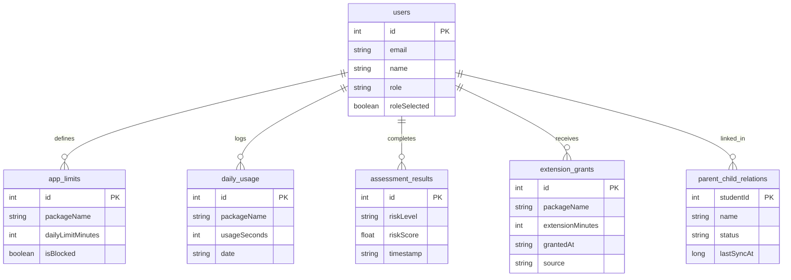
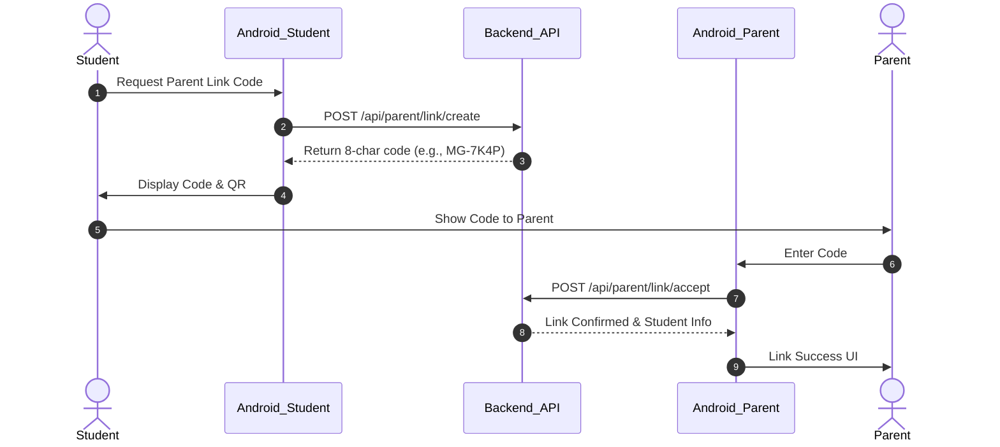
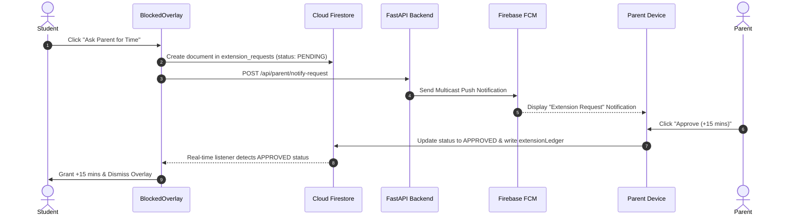

# MindGate — Comprehensive Developer & System Architecture Guide

> **Project Name**: MindGate  
> **Application ID / Package**: `com.mindgate`  
> **Android Root Directory**: `D:/MOVIES/gadget_addiction_project/mindgate-android`  
> **Backend Root Directory**: `D:/MOVIES/gadget_addiction_project/project`  
> **Target Android SDK**: 35 (Android 15) | **Min SDK**: 26 (Android 8.0)  

---

## Table of Contents

1. [Project Overview](#1-project-overview)
2. [Complete Folder Structure](#2-complete-folder-structure)
3. [Complete Feature Documentation](#3-complete-feature-documentation)
4. [Firebase Integration](#4-firebase-integration)
5. [Firebase Security Rules](#5-firebase-security-rules)
6. [Backend Documentation](#6-backend-documentation)
7. [Database Documentation](#7-database-documentation)
8. [System Architecture and Data Flow](#8-system-architecture-and-data-flow)
9. [Build and Run Instructions](#9-build-and-run-instructions)
10. [Dependencies and Configuration](#10-dependencies-and-configuration)
11. [Current Status and Future Work](#11-current-status-and-future-work)
12. [Development Guidelines](#12-development-guidelines)

---

## 1. Project Overview

### 1.1 Objectives & Problem Statement
Modern digital environments present severe challenges regarding excessive screen time, gadget addiction, and cognitive overload among students. Existing usage limit software relies heavily on simple time locks, which users easily bypass or ignore.

**MindGate** is a full-stack digital wellness platform designed to predict, monitor, and regulate gadget usage using machine learning and cognitive reinforcement. It combines:
1. **AI/ML Addiction Risk Prediction**: A CatBoost machine learning model trained on a 34-question survey that predicts addiction risk levels (`Low`, `Moderate`, `High`, `Severe`) with SHAP factor explainability.
2. **Local Hard-Block Overlay**: An Android Accessibility + UsageStats system that restricts app usage when time limits are reached.
3. **Cognitive Puzzle Extensions**: Earned-time functionality where students solve math or trivia challenges to earn short 15-minute extensions.
4. **Parental Oversight System**: Asymmetric QR/code pairing, live monitoring dashboards, real-time push alerts, and approval workflows.
5. **Teacher Analytics Portal**: Batch dataset upload (CSV/XLSX) and class-wide risk distribution reporting.

### 1.2 Target Users & Roles
* **Student (`student`)**: Completes self-assessments, tracks screen time, configures local app limits, solves puzzles for extensions, and requests parental approvals.
* **Parent (`parent`)**: Links with student accounts via secure 8-character codes or QR codes, views usage breakdowns, receives limit alerts, and grants or denies time extension requests.
* **Teacher (`teacher`)**: Evaluates classroom-wide digital health by uploading student assessment datasets and reviewing individual SHAP risk factors.

### 1.3 Tech Stack & Libraries
* **Android Application**:
  * **Language**: Kotlin `1.9.22`
  * **UI Framework**: Jetpack Compose (Material 3, Material Icons Extended, Navigation Compose)
  * **Dependency Injection**: Hilt (Dagger-Hilt `2.50`)
  * **Local Persistence**: Room Database (`2.6.1`), DataStore Preferences (`1.0.0`)
  * **Background Execution**: WorkManager (`2.9.0`), Foreground Services, Accessibility Service
  * **Networking**: Retrofit 2 (`2.9.0`), OkHttp 4 (`4.12.0`), Gson
  * **Firebase Integration**: Firebase Auth, Cloud Firestore, Firebase Cloud Messaging (FCM)
  * **Media & Animation**: Coil Compose (`2.5.0`), Lottie Compose (`6.3.0`), YouTube Player (`12.1.0`)
* **Backend API & ML Engine**:
  * **Language & Framework**: Python 3.x, FastAPI (`1.0.0`), Uvicorn
  * **ML Pipeline**: CatBoost, scikit-learn, pandas, SHAP explainability engine
  * **Database**: SQLite (`mindgate_backend.db`) with SQLAlchemy ORM
  * **Firebase Admin**: `firebase-admin` SDK for Custom Token generation and FCM Multicast Push Notifications

---

## 2. Complete Folder Structure

### 2.1 Project Directory Tree

```
gadget_addiction_project/
├── mindgate-android/                     # Android Studio Project Root
│   ├── build.gradle.kts                  # Top-level Gradle script
│   ├── settings.gradle.kts               # Gradle settings & repositories
│   ├── firestore.rules                   # Firebase Firestore Security Rules
│   ├── MINDGATE_PROJECT_GUIDE.md         # This Project Documentation
│   └── app/                              # Android App Subproject Module
│       ├── build.gradle.kts              # App dependencies, SDK config, API_BASE_URL
│       ├── google-services.json          # Firebase project configuration
│       └── src/main/
│           ├── AndroidManifest.xml       # App components, permissions, receivers
│           ├── res/                      # Drawables, XMLs, Strings, Values, Themes
│           └── java/com/mindgate/
│               ├── MainActivity.kt       # Host activity, deep-link handling, verifier
│               ├── MindGateApp.kt        # Application class, Hilt entry point, channels
│               ├── data/
│               │   ├── local/
│               │   │   ├── PreferencesManager.kt   # Encrypted DataStore preferences
│               │   │   ├── SessionManager.kt       # User credentials & JWT token store
│               │   │   ├── content/ExploreContentLibrary.kt # Curated video library
│               │   │   ├── dao/                    # Room DAOs (12 interfaces)
│               │   │   │   ├── AppLimitDao.kt
│               │   │   │   ├── AssessmentDao.kt
│               │   │   │   ├── BehaviorSignalDao.kt
│               │   │   │   ├── CheckInDao.kt
│               │   │   │   ├── ExtensionGrantDao.kt
│               │   │   │   ├── ParentDao.kt
│               │   │   │   ├── SettingsDao.kt
│               │   │   │   ├── StudySessionDao.kt
│               │   │   │   ├── UsageDao.kt
│               │   │   │   ├── UsageLimitEventDao.kt
│               │   │   │   └── UserDao.kt
│               │   │   ├── database/
│               │   │   │   └── MindGateDatabase.kt # Room Database (Version 14, 15 tables)
│               │   │   └── entities/               # Room Entities (15 classes)
│               │   ├── remote/
│               │   │   ├── api/
│               │   │   │   ├── MindGateApiService.kt # FastAPI Retrofit endpoints
│               │   │   │   └── ParentApiService.kt   # Parent endpoint mappings
│               │   │   ├── dto/                    # Data Transfer Objects
│               │   │   └── util/NetworkResult.kt   # Network wrapper
│               │   └── repository/                 # Repository layer (13 repositories)
│               ├── di/                             # Hilt Dependency Injection Modules
│               │   ├── AppModule.kt                # Network, Database, Session providers
│               │   ├── EntryPoint.kt               # Non-DI component entry point
│               │   ├── FirebaseModule.kt           # Firebase Auth & Firestore singletons
│               │   └── ParentModule.kt             # Parent repository bindings
│               ├── domain/
│               │   ├── manager/
│               │   │   ├── ExtensionManager.kt     # Extension validation & grants
│               │   │   └── PolicyEngine.kt         # Hard limit evaluation
│               │   ├── model/                      # Domain models (Challenge, Request)
│               │   └── usecase/UseCases.kt         # Domain use case wrappers
│               ├── parent/                         # Parent Monitoring & Watchdog
│               │   ├── ApprovalReceiver.kt         # Broadcast receiver for request approvals
│               │   ├── BootRestartReceiver.kt      # Restarts services on boot
│               │   ├── ParentApprovalListenerService.kt # Real-time Firestore request listener
│               │   ├── ServiceHealthCheckWorker.kt # Watchdog worker for background services
│               │   └── manager/ParentServiceManager.kt
│               ├── presentation/
│               │   ├── navigation/
│               │   │   ├── NavGraph.kt             # Main Navigation Host
│               │   │   ├── RoleGuard.kt            # Role-based route authorization
│               │   │   └── Screen.kt               # Screen route definitions
│               │   ├── ui/
│               │   │   ├── applimit/               # Limit setup & reschedule UI
│               │   │   ├── assessment/             # 34-question survey screens
│               │   │   ├── auth/                   # Login & registration screens
│               │   │   ├── blocked/                # Hard overlay activity & dialogs
│               │   │   ├── explore/                # Video player & wellness videos
│               │   │   ├── home/                   # Student dashboard
│               │   │   ├── onboarding/             # Intro slides & role selection gate
│               │   │   ├── parent/                 # Parent dashboard, detail, alerts
│               │   │   ├── profile/                # Student profile & history
│               │   │   ├── quiz/                   # Cognitive puzzle screens
│               │   │   ├── result/                 # ML Risk result report screen
│               │   │   ├── role/                   # Role selection screen
│               │   │   ├── settings/               # Dynamic API URL configuration
│               │   │   ├── splash/                 # Splash & session evaluation
│               │   │   ├── student/                # Student parent connection UI
│               │   │   ├── teacher/                # Batch upload & class analytics
│               │   │   └── theme/                  # Material 3 typography, colors, motion
│               │   └── viewmodel/                  # ViewModels for Compose UI
│               ├── service/                        # Android Service Layer
│               │   ├── DailyResetWorker.kt         # Midnight limit & counter reset
│               │   ├── MindGateAccessibilityService.kt # Foreground app blocker
│               │   ├── ProtectionWatchdogService.kt# Monitoring watchdog
│               │   ├── QuietHoursReceiver.kt       # Scheduled lock receiver / WorkScheduler
│               │   ├── UsageMonitorService.kt      # Active UsageStats polling service
│               │   ├── UsageMonitorWorker.kt       # Periodic usage background worker
│               │   └── sync/UsageLimitEventSyncWorker.kt # Offline event sync worker
│               └── util/                           # Utility Classes
│                   ├── AppInfoHelper.kt            # Installed application loader
│                   ├── AssessmentMapper.kt         # Converts UI survey answers to API DTO
│                   ├── Constants.kt                # Application constants
│                   ├── FirebaseConnectionVerifier.kt # Debug Firestore connection tester
│                   ├── HapticHelper.kt             # Tactile feedback utility
│                   ├── MindGateLog.kt              # System logger
│                   ├── PasswordHasher.kt           # SHA-256 local hash utility
│                   ├── PermissionHelper.kt         # Special permissions helper
│                   └── UsageStatsHelper.kt         # Android UsageStatsManager interface
└── project/                                        # FastAPI Backend & ML Engine Root
    ├── main.py                                     # Top-level CLI entry point
    ├── requirements.txt                            # Python dependencies
    ├── mindgate_backend.db                         # SQLite backend database
    ├── api/
    │   ├── main.py                                 # FastAPI application routes
    │   ├── auth.py                                 # JWT & Password verification
    │   ├── database.py                             # SQLAlchemy engine & session setup
    │   ├── firebase_utils.py                       # Firebase Admin SDK & FCM engine
    │   ├── models.py                               # SQLAlchemy ORM models
    │   ├── model_service.py                        # ML Model wrapper & prediction engine
    │   └── schemas.py                              # Pydantic request/response schemas
    ├── src/                                        # ML Pipeline Source Code
    └── secrets/
        └── firebase-service-account.json           # Firebase Admin Service Account (Ignored)
```

---

## 3. Complete Feature Documentation

Below is the verified implementation status for each feature within the MindGate repository.

| Feature Name | Implementation Status | Primary Associated Files | Description & Workflow |
| :--- | :--- | :--- | :--- |
| **Student Auth & Local Session** | **Implemented & Verified** | `AuthScreen.kt`, `AuthViewModel.kt`, `SessionManager.kt`, `UserDao.kt`, `api/auth.py` | Registration/Login supporting JWT tokens from FastAPI backend and custom Firebase token synchronization. Stores user profile locally in Room and session tokens in DataStore. |
| **Parent Auth & Roles** | **Implemented & Verified** | `RoleSelectionScreen.kt`, `AuthScreen.kt`, `RoleGuard.kt`, `api/auth.py` | Role-based authentication where accounts register as `student`, `parent`, or `teacher`. Navigation routes are guarded by `RoleGuard.kt`. |
| **34-Question Assessment** | **Implemented & Verified** | `AssessmentScreen.kt`, `AssessmentQuestions.kt`, `AssessmentMapper.kt`, `api/main.py` | Survey matching the ML dataset. `AssessmentMapper.kt` converts responses into `PredictionRequest` for the FastAPI backend. |
| **AI Addiction Prediction & SHAP** | **Implemented & Verified** | `ResultScreen.kt`, `ResultViewModel.kt`, `api/model_service.py`, `recommendation_engine.py` | Sends assessment data to `/predict`. Receives risk band (`Low`, `Moderate`, `High`, `Severe`), risk score (0-100), top SHAP contributing factors, and personalized recommendations. |
| **App Usage Monitoring** | **Implemented & Verified** | `UsageMonitorService.kt`, `UsageStatsHelper.kt`, `UsageDao.kt`, `UsageMonitorWorker.kt` | Polling service using `UsageStatsManager` to measure app usage against local limits stored in Room DB. |
| **Hard-Block Application Overlay** | **Implemented & Verified** | `MindGateAccessibilityService.kt`, `BlockedOverlayActivity.kt`, `PolicyEngine.kt` | Accessibility service detects foreground app package. If daily limit is exhausted, `BlockedOverlayActivity` is launched as a single instance over the target app. |
| **Cognitive Puzzle Extension** | **Implemented & Verified** | `QuizPuzzleActivity.kt`, `QuizPuzzleViewModel.kt`, `ChallengeGenerator.kt`, `ExtensionManager.kt` | Accessible directly from the `BlockedOverlayActivity`. Student solves math or trivia challenges to earn a 15-minute usage extension logged locally in Room DB (`ExtensionGrant`). |
| **Parent Extension Requests** | **Implemented & Verified** | `BlockedOverlayActivity.kt`, `FirestoreRepository.kt`, `ParentApprovalListenerService.kt` | Student triggers an approval request to their linked parent. Creates a Firestore document in `extension_requests` with status `PENDING` and triggers an FCM push notification to parent devices. |
| **Parent Approval/Rejection** | **Implemented & Verified** | `ParentDashboardScreen.kt`, `ParentAlertsScreen.kt`, `ApprovalReceiver.kt`, `FirestoreRepository.kt` | Parents review pending requests in the dashboard or via push notifications. Approving updates status to `APPROVED` and writes to `extensionLedger`. Student background service listens via `ParentApprovalListenerService` and auto-grants time. |
| **Student-Parent Account Linking** | **Implemented & Verified** | `ParentConnectionScreen.kt`, `ParentLinkStudentScreen.kt`, `ParentRepository.kt`, `api/main.py` | Student generates an 8-character code (`MG-XXXX`) valid for 3 minutes. Parent enters or scans the code. FastAPI `/api/parent/link/accept` creates a link record and writes `parentChildLinks` in Firestore. |
| **Teacher Batch Analytics** | **Implemented & Verified** | `TeacherDashboardScreen.kt`, `TeacherResultsScreen.kt`, `TeacherViewModel.kt`, `api/main.py` | Teachers log in and upload CSV or XLSX datasets (up to 2,000 student records). FastAPI `/predict/batch/file` computes predictions and returns class risk distribution and individual student SHAP values. |
| **Dynamic API Base URL** | **Implemented & Verified** | `ConnectionSettingsScreen.kt`, `SessionManager.kt`, `AppModule.kt` | Allows physical devices to change the backend API server URL at runtime without recompiling the APK. Includes built-in API health check testing. |
| **Google Sign-In** | **Partially Implemented** | `AuthScreen.kt`, `api/auth.py` | Google Auth library integrated in `build.gradle.kts` and backend endpoint `/api/auth/google` implemented. UI integration requires Google OAuth Client ID setup. |
| **Quiet Hours / Bedtime Lock** | **Partially Implemented** | `QuietHoursReceiver.kt`, `UserSettingsEntity.kt` | Receivers and entity structures exist; complete user scheduling interface is under active refinement. |

---

## 4. Firebase Integration

### 4.1 Firebase Configuration & Initialization
* **Project Name**: Gadget Usage Control
* **Project ID**: `gadget-usage-control`
* **Package Name**: `com.mindgate`
* **Config File**: `D:/MOVIES/gadget_addiction_project/mindgate-android/app/google-services.json`
* **Client ID**: `667786982333-okvfhf9gqp9c220rt5ocl33qh5mnfi3c.apps.googleusercontent.com`

Firebase is initialized on startup in `MindGateApp.kt` via Hilt's `FirebaseModule.kt`:
```kotlin
@Module
@InstallIn(SingletonComponent::class)
object FirebaseModule {
    @Provides
    @Singleton
    fun provideFirebaseAuth(): FirebaseAuth = FirebaseAuth.getInstance()

    @Provides
    @Singleton
    fun provideFirestore(): FirebaseFirestore = FirebaseFirestore.getInstance()
}
```

### 4.2 Custom Token Authentication Flow
1. User logs in via FastAPI `/token` endpoint using standard credentials.
2. The FastAPI backend uses the **Firebase Admin SDK** (`firebase_utils.py`) to generate a Firebase Custom Token carrying custom claims (`role`).
3. The Android client receives `firebase_token` in the login response and calls `FirebaseAuth.getInstance().signInWithCustomToken(token)`.
4. This ensures that the user's Firebase Auth UID matches their database identity, enabling secure Firestore security rules evaluation.

### 4.3 Firestore Collections Schema

1. **`extension_requests`**:
   * `studentUid` (String): Firebase Auth UID of the student.
   * `parentUid` (String): Firebase Auth UID of the parent.
   * `appPackage` (String): Package name of the requested app (e.g., `com.instagram.android`).
   * `appName` (String): Display name of the application.
   * `studentName` (String): Name of the student.
   * `requestedMinutes` (Int): Requested duration (default: 15).
   * `status` (String): `PENDING` | `APPROVED` | `DENIED` | `CONSUMED` | `EARNED`.
   * `requestedAt` (Timestamp): Server timestamp.
   * `respondedAt` (Timestamp): Server timestamp when parent responded.

2. **`parentChildLinks`**:
   * `studentUid` / `studentId` (String): Student identifier.
   * `parentUid` / `parentId` (String): Parent identifier.
   * `linkedAt` (Timestamp): Timestamp when pairing was completed.

3. **`extensionLedger`**:
   * `requestId` (String): Foreign key to `extension_requests`.
   * `studentUid` (String): Student UID.
   * `parentUid` (String): Parent UID.
   * `appPackage` (String): Target app package.
   * `grantedAt` (Timestamp): Server timestamp.

4. **`deviceTokens`**:
   * Document ID: `userId` (Firebase Auth UID).
   * `fcmToken` (String): FCM registration token.
   * `updatedAt` (Timestamp): Server timestamp.

### 4.4 Cloud Messaging (FCM) Data Flow
* On app startup, `MainActivity.kt` fetches the device FCM token via `FirebaseMessaging.getInstance().token` and updates `deviceTokens/{uid}` in Firestore.
* When a student submits an extension request, the backend (`/api/parent/notify-request`) or Firestore triggers a multicast FCM push notification to registered parent devices.
* Parent devices receive notifications and can directly approve or deny the request.

---

## 5. Firebase Security Rules

The active security rules file is located at `D:/MOVIES/gadget_addiction_project/mindgate-android/firestore.rules`.

```javascript
rules_version = '2';
service cloud.firestore {
  match /databases/{database}/documents {

    match /extension_requests/{requestId} {

      // 1. CREATE: Only authenticated students can create requests for themselves.
      allow create: if request.auth != null &&
                    request.resource.data.studentUid == request.auth.uid &&
                    (request.resource.data.status == 'PENDING' || request.resource.data.status == 'EARNED') &&
                    request.resource.data.parentUid is string &&
                    request.resource.data.parentUid != "";

      // 2. READ: Only the student or the specifically linked parent can read.
      allow read: if request.auth != null &&
                  (resource.data.studentUid == request.auth.uid ||
                   resource.data.parentUid == request.auth.uid);

      // 3. UPDATE: Strict role-based status transition.
      allow update: if request.auth != null && (
        // A. Parent transition: PENDING -> APPROVED or DENIED
        (resource.data.parentUid == request.auth.uid &&
         resource.data.status == 'PENDING' &&
         (request.resource.data.status == 'APPROVED' || request.resource.data.status == 'DENIED'))
        ||
        // B. Student transition: APPROVED -> CONSUMED (Replay Protection)
        (resource.data.studentUid == request.auth.uid &&
         resource.data.status == 'APPROVED' &&
         request.resource.data.status == 'CONSUMED')
      ) &&
      request.resource.data.studentUid == resource.data.studentUid &&
      request.resource.data.parentUid == resource.data.parentUid;
    }

    // Default block for all other unmapped collections
    match /{path=**} {
      allow read, write: if false;
    }
  }
}
```

---

## 6. Backend Documentation

### 6.1 Architecture & Entry Points
* **CLI Entry Point**: `project/main.py`
  * `python main.py train`: Executes ML model training pipeline.
  * `python main.py serve`: Launches FastAPI via Uvicorn on `http://0.0.0.0:8000`.
* **API Engine**: `project/api/main.py`

### 6.2 Key API Endpoints

#### Authentication & User Management
* `POST /token`: Authenticates user; returns OAuth2 Bearer token, user role, and Firebase Custom Token.
* `POST /api/register`: Registers new `student`, `parent`, or `teacher` account.
* `POST /api/user/select-role`: Assigns user role during initial setup.
* `POST /api/auth/google`: Authenticates Google ID Token.
* `POST /api/auth/google/complete`: Completes registration for new Google accounts.
* `GET /api/user/connection-status`: Returns parent-child linkage status.

#### Machine Learning & Analytics
* `GET /health`: Returns API health status, loaded model name, and uptime.
* `POST /predict`: Single student assessment prediction. Returns risk level, risk score (0-100), SHAP factors, and recommendations.
* `POST /predict/batch`: Processes up to 100 student records in a single JSON payload.
* `POST /predict/batch/file`: Processes CSV/XLSX files containing up to 2,000 student records for classroom analytics.
* `GET /risk-levels`: Returns risk classification bands (`Low`, `Moderate`, `High`, `Severe`).
* `GET /recommendations/{risk_level}`: Fetches recommendation set for a given risk level.

#### Parent-Child Linkage & Monitoring
* `POST /api/parent/link/create`: Generates an 8-character, 3-minute link code (`MG-XXXX`).
* `POST /api/parent/link/accept`: Accepts link code and establishes active parent-child relationship.
* `GET /api/parent/children`: Lists all children linked to the parent account.
* `GET /api/parent/children/{student_id}/status`: Summarizes student usage vs. limit for today.
* `GET /api/parent/children/{student_id}/usage`: Detailed per-app usage breakdown for a student.
* `POST /api/usage/sync-full`: Student device pushes local app usage snapshots.
* `POST /api/usage/limit-event`: Records limit breach event with 20-minute alert throttling.
* `POST /api/parent/notify-request`: Triggers FCM push notification to parents for extension requests.

---

## 7. Database Documentation

### 7.1 Local Android Room Database (`MindGateDatabase` v14)



### 7.2 Backend SQLite Database Schema (`mindgate_backend.db`)

1. `users`: Stores user credentials, hashed passwords, roles (`student`, `parent`, `teacher`), and `firebase_uid`.
2. `parent_child_relation`: Stores active pairing mappings (`parent_id`, `student_id`, `status`).
3. `parent_link_token`: Stores short-lived pairing tokens (`token_hash`, `expires_at`, `attempt_count`, `used`).
4. `device_registration`: Maps user IDs to FCM device push tokens (`device_id`, `push_token`, `platform`).
5. `usage_limit_event`: Stores limit exceed event logs (`student_id`, `app_package`, `limit_seconds`, `actual_usage_seconds`).
6. `notification_event`: Enforces 20-minute notification throttling bucket (`student_id`, `parent_id`, `cooldown_bucket`, `status`).
7. `usage_snapshot`: Real-time daily app usage records synced from student devices (`student_id`, `app_package`, `used_seconds`, `event_date`).
8. `extension_ledger`: Audit log of granted time extensions (`student_id`, `app_package`, `extension_minutes`, `source`).

---

## 8. System Architecture and Data Flow

### 8.1 Overall System Architecture

```mermaid
graph TD
    subgraph Android App ("com.mindgate")
        UI[Compose UI Layer]
        VM[ViewModels]
        RM[(Room Local DB)]
        DS[DataStore Session]
        ACC[Accessibility Service]
        USM[UsageStats Monitor]
        FSR[Firestore Repository]
    end

    subgraph FastAPI Backend ("Python / Uvicorn")
        API[FastAPI Endpoints]
        ML[CatBoost Risk Engine]
        SQL[(SQLite DB)]
        FBA[Firebase Admin SDK]
    end

    subgraph Firebase Cloud
        FAUTH[Firebase Auth]
        FSTORE[(Cloud Firestore)]
        FCM[Cloud Messaging]
    end

    UI --> VM
    VM --> RM
    VM --> DS
    ACC --> RM
    USM --> RM

    VM -- Retrofit REST --> API
    FSR -- Firebase SDK --> FSTORE
    
    API --> ML
    API --> SQL
    API --> FBA
    FBA --> FAUTH
    FBA --> FCM
```

### 8.2 Student-Parent Linkage Flow



### 8.3 Parent Request Approval & Notification Flow



---

## 9. Build and Run Instructions

### 9.1 Prerequisites
1. **Android Studio**: Jellyfish | 2023.3.1 or newer.
2. **JDK**: Java 17.
3. **Python**: Python 3.9+ with `venv`.
4. **Android Device / Emulator**: Running Android 8.0 (API 26) or higher.

### 9.2 Step-by-Step Setup

#### 1. Start FastAPI Backend
```bash
# Navigate to backend directory
cd D:/MOVIES/gadget_addiction_project/project

# Activate virtual environment
venv\Scripts\activate

# Install dependencies if required
pip install -r requirements.txt

# Start backend server
python main.py serve
```
* The API documentation will be available at `http://localhost:8000/docs`.

#### 2. Open Android Studio Project
1. Launch Android Studio.
2. Select **Open** and navigate to `D:/MOVIES/gadget_addiction_project/mindgate-android`.
3. Wait for Gradle Sync to complete successfully.

#### 3. Configure API Base URL
* **Emulator**: Uses default `http://10.0.2.2:8000/`.
* **Physical Device**:
  1. Ensure physical phone and PC are connected to the same Wi-Fi network.
  2. Find PC local IP (`ipconfig` on Windows, e.g., `192.168.0.102`).
  3. Update `app/build.gradle.kts`:
     ```kotlin
     val apiUrl = project.findProperty("api.url")?.toString() ?: "http://192.168.0.102:8000/"
     ```
  4. Alternatively, use the in-app **Connection Settings** screen (gear icon on login/role screens) to update the backend URL dynamically at runtime.

#### 4. Run Application
1. Connect target device or launch emulator.
2. Select `app` run configuration and click **Run**.
3. Grant required permissions after setup:
   * **Usage Access** (`Settings -> Special App Access -> Usage Access`)
   * **Accessibility Service** (`Settings -> Accessibility -> MindGate`)
   * **Display over other apps** (Overlay Permission)

---

## 10. Dependencies and Configuration

### 10.1 Key Gradle Versions (`app/build.gradle.kts`)
* `compileSdk` = 35
* `targetSdk` = 35
* `minSdk` = 26
* Kotlin Compiler Extension = `1.5.10`
* Hilt = `2.50`
* Room = `2.6.1`
* Firebase BoM = `33.1.2`
* Compose BoM = `2024.02.00`
* Retrofit = `2.9.0`
* WorkManager = `2.9.0`

### 10.2 Android Permissions (`AndroidManifest.xml`)
* `android.permission.INTERNET`
* `android.permission.PACKAGE_USAGE_STATS`
* `android.permission.SYSTEM_ALERT_WINDOW`
* `android.permission.BIND_ACCESSIBILITY_SERVICE`
* `android.permission.FOREGROUND_SERVICE`
* `android.permission.POST_NOTIFICATIONS`
* `android.permission.RECEIVE_BOOT_COMPLETED`

---

## 11. Current Status and Future Work

| Feature Module | Status | Relevant Files | Known Issues / Notes | Recommended Action |
| :--- | :--- | :--- | :--- | :--- |
| **Assessment & Risk Prediction** | **Complete** | `AssessmentScreen.kt`, `api/model_service.py` | Fully functional with CatBoost model and SHAP calculation. | Maintain feature set. |
| **Hard-Block App Overlay** | **Complete** | `MindGateAccessibilityService.kt`, `BlockedOverlayActivity.kt` | Requires Accessibility permission enabled on device. | Add explicit in-app guidance if Accessibility service is stopped by OS. |
| **Cognitive Puzzle Extension** | **Complete** | `QuizPuzzleActivity.kt`, `ChallengeGenerator.kt` | Math and trivia generators functional. | Expand puzzle variety in future releases. |
| **Parent Link & Approval** | **Complete** | `ParentApprovalListenerService.kt`, `FirestoreRepository.kt` | Asymmetric pairing and push notifications verified. | Monitor FCM token refreshes. |
| **Teacher Batch Analytics** | **Complete** | `TeacherDashboardScreen.kt`, `api/main.py` | Supports CSV/XLSX up to 2,000 rows. | None required. |
| **Google Authentication** | **Partial** | `AuthScreen.kt`, `api/auth.py` | API backend handles tokens; UI integration needs client ID config. | Complete UI sign-in button binding. |

---

## 12. Development Guidelines

To ensure project consistency and stability across development iterations, follow these rules:

1. **Inspect Before Modifying**: Always read existing repository code and architecture before writing new implementations.
2. **Reuse Existing Components**: Use `SessionManager`, `FirestoreRepository`, `MindGateDatabase`, and `MindGateApiService` rather than duplicating logic.
3. **Preserve Firebase Mappings**: Do not alter collection names (`extension_requests`, `parentChildLinks`, `deviceTokens`) or field schemas.
4. **Buffer-Safe Edits**: Use targeted file modifications (`replace_file_content` or `write_file`) to keep memory buffers synchronized with Android Studio.
5. **Never Commit Secrets**: Never commit passwords, private keys, service account JSON files, or API keys to repository commits.
6. **Maintain System Compatibility**: Keep package names (`com.mindgate`), SDK versions (`compileSdk 35`), and dependencies aligned with current project specifications.
7. **Document Updates**: Update this guide (`MINDGATE_PROJECT_GUIDE.md`) whenever major architecture or feature implementations change.
