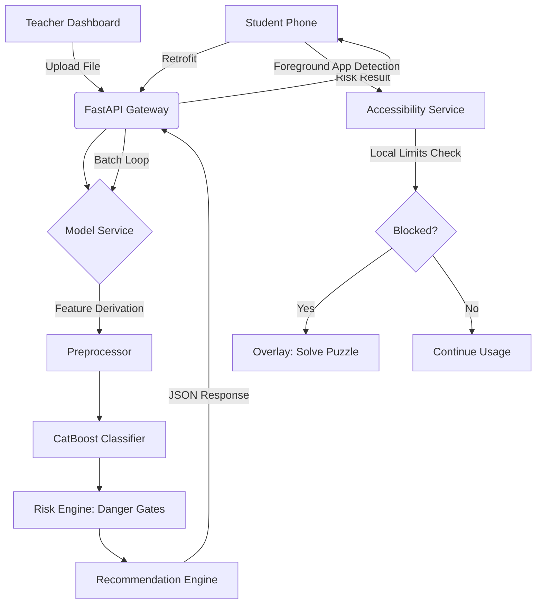

# MindGate: Technical Architecture & System Workflow

This document provides a deep dive into the technology stack, file structure, and architectural workflow of the MindGate Gadget Addiction Prediction & Intervention System.

---

## 🛠 Technology Stack

### **Android Client (Mobile)**
- **Language**: Kotlin
- **UI Framework**: Jetpack Compose (Modern declarative UI)
- **Networking**: Retrofit 2 + OkHttp 3 (REST API communication)
- **Local Database**: Room DB (User profiles, usage logs, assessment history)
- **Dependency Injection**: Hilt (Dagger-based DI for Android)
- **Background Processing**: WorkManager (Daily resets, usage sync)
- **State Management**: Kotlin Coroutines & Flow (Reactive UI updates)
- **Device Interaction**: 
    - **Accessibility Service**: Real-time app monitoring and active blocking.
    - **UsageStats Manager**: Tracking time spent in third-party applications.
- **Security**: DataStore (Preferences), Password Hashing (Local).

### **ML Backend (API)**
- **Framework**: FastAPI (High-performance asynchronous Python API)
- **Machine Learning**: 
    - **CatBoost**: Primary classification model (Optimized for categorical data).
    - **Scikit-learn**: Feature scaling and pipeline management.
    - **SHAP**: Game-theory based explainability for risk factors.
- **Data Engineering**: Pandas (Batch file processing & cleaning).
- **Validation**: Pydantic v2 (Strict type-safe request/response schemas).
- **Server**: Uvicorn (ASGI server).

---

## 📁 System Structure

### **Android Module (`/app`)**
```
com.mindgate/
├── data/
│   ├── local/          # Room DB (Entities, DAOs) & Preferences
│   ├── remote/         # Retrofit API Service & DTOs
│   └── repository/     # Single source of truth for Data/UI
├── domain/             # Business logic & Domain Models
├── presentation/
│   ├── navigation/     # NavHost & Screen definitions
│   ├── ui/             # Compose Screens (Home, Auth, Teacher, Result)
│   └── theme/          # Material 3 Styling
├── service/            # AccessibilityService & WorkManager
├── di/                 # Hilt Modules
└── util/               # Mappers, Formatters, Constants
```

### **ML Backend Module (`/project`)**
```
project/
├── api/                # FastAPI routes, schemas, and model service
├── src/                # Preprocessing, EDA, and Feature Derivation
├── models/             # Serialized (.pkl) artifacts & default inputs
├── configs/            # Global ML parameters & mapping dictionaries
├── risk_engine.py      # Clinical danger-gate logic
└── recommendation_engine.py # Tiered wellness suggestions
```

---

## 🔄 System Workflows

### **1. Student Onboarding & Assessment**
1. **Local Auth**: Student registers/logs in; data is stored securely in Room DB.
2. **Assessment**: Student completes a 34-question survey covering usage, sleep, and psychological factors.
3. **Inference**:
 Data is sent to the backend. The `ModelService` derives missing features, runs the **CatBoost** model, and applies **Danger Gates**.
4. **Intervention**: Result is returned with a Risk Level and SHAP-based factors. Digital wellness tips are tailored to the student's specific triggers (e.g., late-night usage).
### **2. Active Digital Wellness (Accessibility)**
1. **Granting Permissions**: Student enables Accessibility and Usage Access.
2. **Real-time Monitor**: `MindGateAccessibilityService` detects which app is in the foreground.
3. **Active Blocking**: If a restricted app exceeds its daily limit, an **Overlay View** is triggered.
4. **Puzzle Loop**: Student must solve a math/logic puzzle to gain a temporary (15min) extension.

### **3. Teacher Analytics (Batch Classification)**
1. **Data Ingestion**: Teacher uploads a classroom CSV/Excel file.
2. **Sanitization**: Backend cleans the file, imputes missing values, and validates types against the Pydantic schema.
3. **Mass Prediction**: Backend processes all rows (up to 2,000) using vectorized prediction.
4. **Dashboard**: Teacher sees an aggregated **Overview** (Distribution chart) and **Individual Risk** list with top contributing factors for every student.

---

## 🏗 Workflow Architecture Diagram



---
*MindGate - Technical Documentation v1.0.1*
